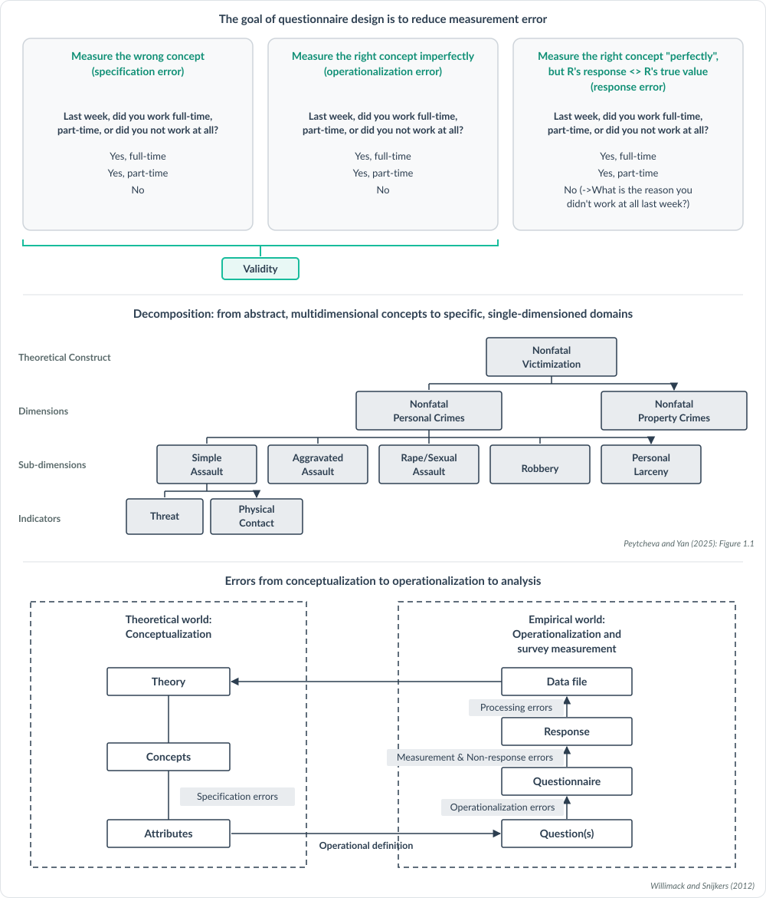
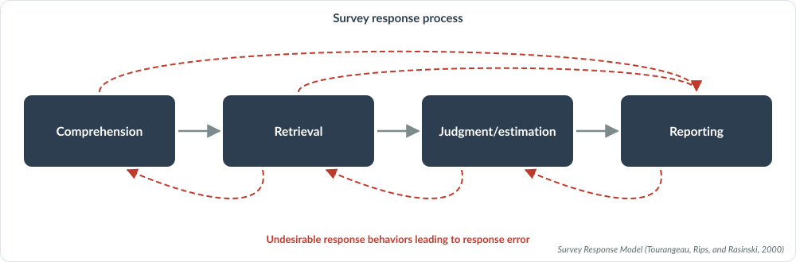

# How QuestionR works and what stands behind it

QuestionR uses an AI model as an **expert reviewer** of survey questions and as an **item writer**. The model is not asked for its opinion. It is given written rules of questionnaire design, called AI reflexes, and applies them to your questions. This note says what error the tool works on, which frameworks the reflexes come from, and what the tool can and cannot tell you.

## Measurement error

**In plain words.** Measurement error is the gap between the answer a person gives and the answer that is true for them.

**More precisely.** For respondent *i*, the reported value is the true value plus an error: *y = &mu; + &epsilon;*. When the errors lean one way across respondents (people under-report drinking, over-report voting), the estimate is **biased**. When they scatter in both directions (people guess at a number they cannot recall), the estimate is noisier and its **reliability** falls, and relationships with other variables look weaker than they are. The true value is often unknowable, which is why questions are judged by what a respondent has to do to answer them.

In the Total Survey Error framework (the figure on the Start here tab), measurement error sits on the measurement side, between the question and the answer. **Validity** sits one step earlier, between the concept you care about and the question you ask. Processing error comes one step later, when answers are coded and edited. Questionnaire design works on validity and measurement error.

Measurement error has several sources: the respondent, the interviewer, the mode of data collection and the questionnaire. QuestionR sees only the questionnaire, so that is the only source it works on.

*Groves et al. 2009. Survey methodology. Hoboken, N.J.: Wiley (Figure 2.5); Tourangeau, Rips and Rasinski (2000)*

## From construct to question

A question can fail in three ways. It can measure the wrong concept (specification error). It can measure the right concept imperfectly (operationalization error). Or it can measure the right concept well and still receive an answer that differs from the respondent's true value (response error). The first two are failures of validity.

To reduce the first two, move from an abstract concept with several dimensions to specific domains with one dimension each, and write a question for each domain. This is why Write questions asks you for the construct and not only the topic, and why the reviewer checks each question against the construct you name.

*Yan, IASS/WSS Session 1; Willimack and Snijkers (2012); Peytcheva and Yan (2025): Figure 1.1*

## The response process

To answer a question a respondent has to understand it, retrieve the relevant information, form a judgment or an estimate, and report an answer. A problem at any step is a source of response error:

- **Comprehension.** Long or negative sentences, two questions in one, an assumption that does not hold for the respondent, technical or ambiguous words, and what earlier questions suggest.
- **Retrieval.** Old information, frequent everyday events, dates, and things the respondent never noticed.
- **Judgment or estimation.** Respondents often have no ready attitude or count, so they build one on the spot and lean on whatever the context suggests.
- **Reporting.** Answers are sometimes edited before they are given, and the order, labels and layout of the options affect which one is picked.

Every flag QuestionR raises names the step it affects, and the bottom line of a review counts problems by step.

*Tourangeau, Rips and Rasinski (2000), as presented in Yan, IASS/WSS Session 1*

## Sensitive questions

A question is sensitive when it is intrusive, when answering carries a risk of disclosure to the survey organization or someone else, or when one answer looks better than another. Sensitivity is not fixed: it changes with where and how a question is asked, who answers, the culture and the time. The reflexes for sensitive topics come from this work: private, self-administered answering where possible, forgiving and familiar wording, the order of "ever" and "current" questions, open or high-range answer formats, and answer options that let people report without losing face.

*Tourangeau and Yan (2007); Yan (2021); Peytcheva and Yan (2025)*

## How the AI reviewer is kept in check

- **The rules are written down.** Every request carries the same reflexes, and the program, not the model, assembles the instructions. The same input gives the same instructions.
- **Every flag must point at words.** A flag has to quote the words in your question that cause the problem. The program checks that the quote is really there and marks any flag where it is not.
- **Restraint is a rule.** The model is told to report only problems specific to the question and likely to change answers, and is warned about what AI reviewers over-report (sensitivity, burden) and what they miss (assumptions that do not hold for everyone, terms read differently by part of the population).
- **No facts about your country.** Local terms, dates and thresholds are left as [placeholders] for you.
- **New questions are edited, not just generated.** One model writes a draft and a second model checks it against the rules and repairs what fails before you see it.
- **Everything is recorded.** Each result can be downloaded with the model, the date, the reflex versions and the instructions sent.

## How it was tested

The reviewer is run on a published test set: 20 survey questions with 48 planted faults, and 7 well-tested questions from the European Social Survey that should draw few flags (Sturgis, Roberts and Robinson 2026).

In the latest run (14 November 2026, model claude-sonnet-5-5) the reviewer flagged 41 of the 48 planted faults (85 percent): 33 as "fix" and 8 as "consider". It found every question that asks two things at once, every vague term, every recall problem, every case of leading wording and every overlong sentence. It missed three of the four sensitivity faults, two faults that could only be seen with the full answer scale, and two unstated assumptions. On the 7 well-tested questions it raised 2 "fix" flags, both on one question, and "consider" flags on all seven, so expect points to consider on good questions too.

The flags were matched to the planted faults by reading, by the AI model that helped build this tool; a second person has not checked the matching.

Planted faults are clearer than real ones, and one run on one model is a guide, not a guarantee.

## What it cannot do

- It is an expert review and a draft. Expert methods are quick and involve no respondents, so they find only part of what testing finds. Test key questions with real respondents before fielding.
- It can miss faults and can flag things that do not matter. Open the "consider" flags as well as the "fix" ones, and use your own judgment.
- It does not judge whether two language versions of a questionnaire are equivalent, and it does not translate.
- It sees only the text you paste. It does not see interviewers, visual layout, or how the survey is fielded.

## The AI reflexes

A reflex is one written rule. It says when it applies, what to do, what never to do, and, for most rules, a yes-or-no question the reviewer asks of every question. The eight general guidelines for writing survey questions each have their own reflex, and there are further reflexes for behavioral, attitudinal and sensitive questions, for survey mode, and for the questionnaire as a whole. Changing the AI model does not change the rules.

The table below is read from the reflex files themselves, so it is what every model is given.
