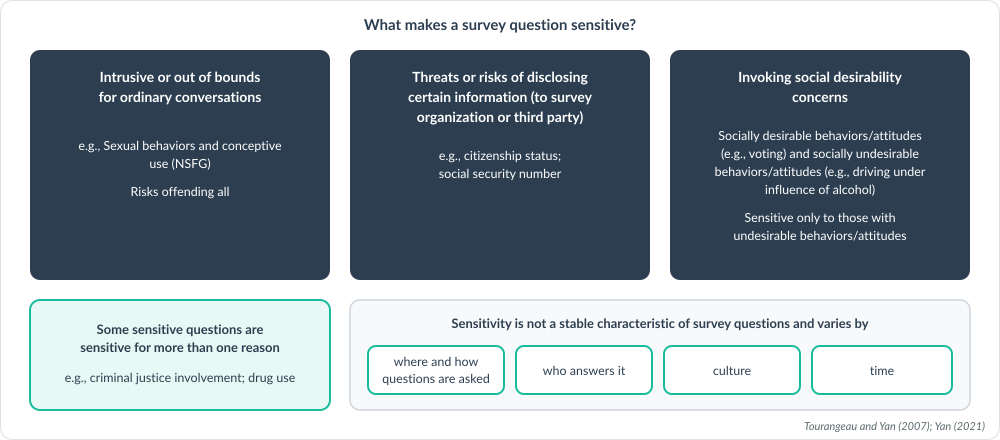

# How QuestionR works and what stands behind it

## Total Survey Error and measurement error

The Total Survey Error framework, and the part of it QuestionR works on, are on the Start here tab.

## From construct to question

*[Text to come.]*

*Willimack and Snijkers (2012); Peytcheva and Yan (2025)*

## The response process

*[Text to come.]*

*Tourangeau, Rips and Rasinski (2000)*

## Sensitive questions

*[Text to come.]*

*Tourangeau and Yan (2007)*

## How the AI reviewer is kept in check

*[Text to come.]*

## How it was tested

*[Text to come.]*

## What it cannot do

It does not judge whether two language versions of a questionnaire are equivalent. *[Text to come.]*

## The AI reflexes

*[Text to come.]* The table below is read from the reflex files themselves, so it is what every model is given.
