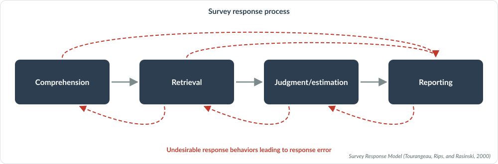
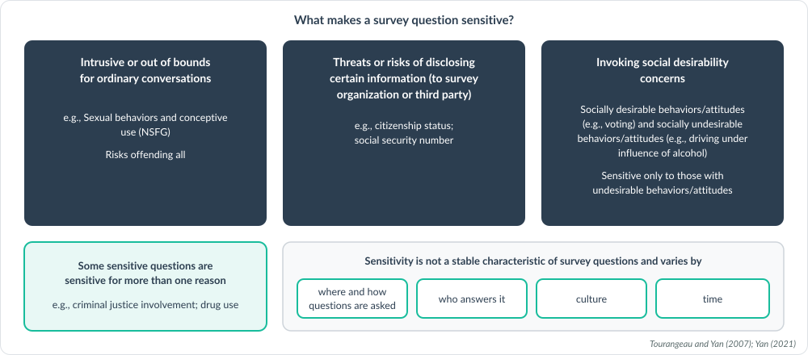

# How QuestionR works and what stands behind it

## What it is built on

The rules QuestionR applies are standard questionnaire design practice, not
the opinions of an AI model. They were drawn from:

- **The Total Survey Error framework** and the model of how people answer
  survey questions: they have to understand the question, recall what is
  needed, form a judgment, and report an answer. Each rule protects one of
  those steps.
- **A webinar series on questionnaire design** given for the International
  Association of Survey Statisticians and the Washington Statistical Society
  by Ting Yan (NORC) and Anna-Carolina Haensch (LMU Munich): general wording
  rules; rules for behavioral, attitudinal and sensitive questions; survey
  mode; putting a questionnaire together; surveys in more than one country
  or language; and the use of AI in questionnaire work.
- **Recent academic studies** of how well AI models write and review survey
  questions, and where they go wrong.
- **Graduate course material** on cognition and survey measurement.

## The frameworks behind the rules

These frameworks are what the reflexes were written from, and each reflex file below
names the ones it draws on.

### Total Survey Error

A survey statistic can be wrong for two kinds of reasons. One kind comes from
the questions: they may not capture the concept you care about (validity), the
answers may not match what is true (measurement error), or the data may be
mishandled afterwards (processing error). The other kind comes from the people:
who could be reached, who was sampled, who answered, and how the answers were
adjusted. The aim is to reduce total survey error within the budget you have.
Questionnaire design works on the two errors the framework calls essential to
it, validity and measurement error.

*Groves et al. 2009. Survey methodology. Hoboken, N.J.: Wiley. (Figure 2.5)*

### From construct to question

A question can fail in three ways. It can measure the wrong concept
(specification error), measure the right concept imperfectly (operationalization
error), or measure the right concept well and still get an answer that differs
from the respondent's true value (response error). The first two together are
validity. To lower them, move from an abstract, multidimensional concept to
specific, single-dimensioned domains. That is why QuestionR starts every draft
from the construct in your brief and writes one item per domain (the rule
construct_first in the core reflex file).

*Willimack and Snijkers (2012); Peytcheva and Yan (2025): Figure 1.1*

### The survey response model

To answer a question, a respondent goes through four stages: comprehension,
retrieval, judgment or estimation, and reporting. A fault at any stage is a
source of measurement error. Respondents do not always go through the stages in
order: they may skip ahead to reporting or go back to an earlier stage, and that
leads to response error. Each of QuestionR's rules protects one stage, and the
reviewing model names the stage when it reports a fault.

*Survey Response Model (Tourangeau, Rips, and Rasinski, 2000)*

### Testing questions, and where AI fits

Questions can be tested in three classes of ways. Expert methods are quick and
inexpensive but involve no actual respondents. Lab-based methods use actual
respondents but are expensive, and field-based methods collect a large amount of
data from actual participants but are resource heavy. The methods find partly
different problems, so use at least one and combine several when you can. A
language model fits in as an expert reviewer, which is what QuestionR's review
is, or as a simulated respondent, which is no substitute for real respondents.

*Tourangeau et al. (2020): Table 3.1*

### Sensitive questions

A question is sensitive when it is intrusive or out of bounds for ordinary
conversation, when answering it risks disclosing something to the survey
organization or a third party, or when it invites a socially desirable answer.
Some questions are sensitive for more than one reason. How sensitive a question
is changes with where and how it is asked, who answers it, the culture and the
time. QuestionR's rules for sensitive topics use forgiving wording, face-saving
answer options and open or high-range formats, and flag when the survey mode
itself matters.

*Tourangeau and Yan (2007); Yan (2021)*

## How it keeps the AI in check

- **The rules are written down.** Every model gets the same rules, and the
  tool shows you the instructions before anything is sent.
- **Several models draft; one reviews.** The reviewing model checks every
  draft against a fixed checklist without knowing which model wrote it. It
  recommends questions exactly as drafted and tells you what it still
  doubts.
- **It does not invent facts about a country.** Local terms, units and
  sensitivities are flagged for someone who knows the setting.
- **Everything is recorded.** Each output states the models used, the date
  and the instructions, so the work can be explained and repeated.

## How it was tested

The review step was run on a published test set: 20 questions with 48
planted faults and 7 well-tested questions from the European Social Survey.
It found 36 of the 48 faults (75 percent) and raised fewer than one concern
for every two well-tested questions. It was strongest on questions that ask
two things at once, recall problems and vague wording, and weakest on
sensitivity. This was one run with one AI model on planted faults, which are
clearer than real ones, so treat it as a guide, not a guarantee.

## What it cannot do

- It is an expert review and a first draft by AI models. It is not a
  pretest and does not show how respondents will understand a question.
- It can miss faults and can raise concerns that do not matter. Use your
  judgment, and look at the minor concerns as well.
- Test key questions with real respondents before fielding, and keep the
  record of AI use with the questionnaire.

## The AI reflexes behind every answer

QuestionR is an AI skill. It works from written AI reflexes: short rules of
survey design that every model is given. It does not rely on what an AI model
happens to know about
questionnaires. With every request it sends the model a set of short text
files, called reflex files, that write the reflexes down. Each reflex says when it
applies, what to do and what never to do, and most carry a yes or no question
that the reviewing model asks of every draft. Every model gets the same
reflex files, so changing the model does not change the reflexes.

| Reflex file | What it covers | When it is used | Frameworks |
|---|---|---|---|
| Core | Who the models are told to be, and what every question must meet | Every request | Total Survey Error; Response model; Construct and decomposition; Testing methods |
| Drafting | How a set of questions is built from your brief | Drafting questions | Session guidelines |
| Attitude scales | Wording, response scales and balance for attitude items | Drafting an attitude scale | Session guidelines |
| Behaviors | Recall, reference periods and counts | Drafting behavior questions | Session guidelines |
| Sensitive topics | Questions people may refuse, or edit their answer to | Drafting sensitive questions | Sensitive questions |
| Survey mode | Web, phone, in person, and more than one mode | Every request; only the modes you choose | Sensitive questions |
| Country and culture | Local terms, sensitivities and context | When you name a country | Response model; Sensitive questions |
| Questionnaire review | Reviewing a questionnaire question by question and as a whole | Reviewing a questionnaire | Testing methods |
| Brief check | What a designer would still need to know from your brief | When you ask for a brief check | Session guidelines |
| Reviewer | How the reviewing model checks the drafts and recommends one set | After the drafts come back | Session guidelines |

The Frameworks column names the frameworks above that the reflex file's sources cite.
"Session guidelines" means its sources name none of them.

Open any reflex file below to read it in full. The reflex files, and the published
studies and webinar materials they draw on, are also in the source code: the
[reflex files](https://github.com/klinares/drsvyr/tree/main/QuestionR/www/reflexes)
and the [list of materials](https://github.com/klinares/drsvyr/tree/main/QuestionR/www/reflex_materials).
