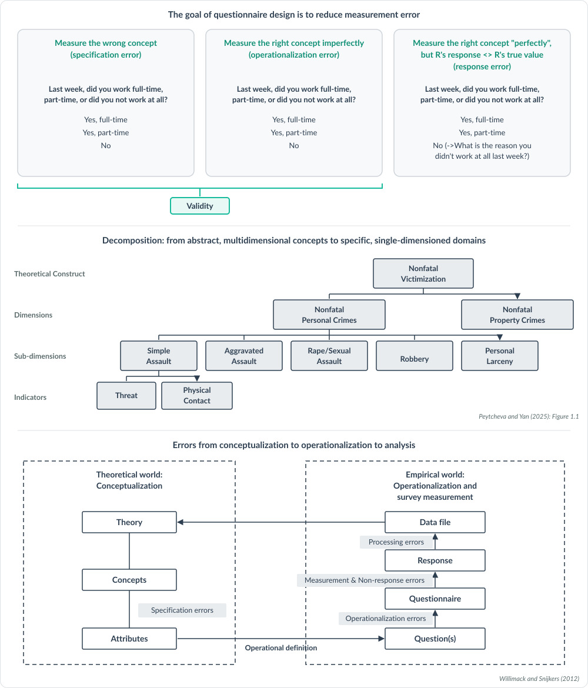

# How QuestionR works and what stands behind it

## Total Survey Error

A survey statistic can be wrong for two kinds of reasons. Some come from the
questions: they may not capture the concept you care about (validity), or the
answers may not match what is true (measurement error). Others come from the
people: who could be reached (coverage), who was sampled (sampling), and who
answered (nonresponse). QuestionR works on validity and measurement error. It
does not work on coverage, sampling or nonresponse.

*Groves et al. 2009. Survey methodology. Hoboken, N.J.: Wiley. (Figure 2.5)*

## What it is built on

The rules are standard questionnaire design practice, not the opinions of an AI
model. They come from a webinar series by Ting Yan (NORC) and Anna-Carolina
Haensch (LMU Munich), recent studies of AI-written survey questions, and
graduate course material.

## From construct to question

QuestionR starts every draft from the construct in your brief and writes one
question for each narrow, single-dimension domain. That lowers specification and
operationalization error.

*Willimack and Snijkers (2012); Peytcheva and Yan (2025): Figure 1.1*

## One question, three ways to go wrong

This question is the worked example from the first webinar session. It can
measure the wrong concept (specification error) or the right concept
imperfectly (operationalization error), and those two together are validity. It
can also measure the right concept well and still get an answer that differs
from the respondent's true value (response error).

*Ting Yan, Fundamentals of Questionnaire Design, IASS/WSS Webinar Session 1*

## The response model

To answer a question, a respondent has to understand it, recall what is needed,
form a judgment and report an answer. A fault at any of these stages is
measurement error. Each of QuestionR's rules protects one of them.

*Survey Response Model (Tourangeau, Rips, and Rasinski, 2000)*

## Testing questions, and where AI fits

Expert methods are quick and cheap but use no real respondents. Lab-based and
field-based methods use real respondents but cost more, and they find different
problems. A language model can act as an expert reviewer, which is what
QuestionR's review is. It is no substitute for real respondents.

*Tourangeau et al. (2020): Table 3.1*

## What it cannot do

QuestionR is an expert review and a first draft by AI models. It is not a
pretest and does not show how respondents will understand a question. It can
miss faults and raise concerns that do not matter. Test key questions with
real respondents.

## How it was tested

The review step was run on a published test set: 20 questions with 48
planted faults and 7 well-tested questions from the European Social Survey.
It found 36 of the 48 faults (75 percent) and raised fewer than one concern
for every two well-tested questions. It was strongest on questions that ask
two things at once, recall problems and vague wording, and weakest on
sensitivity. This was one run with one AI model on planted faults, which are
clearer than real ones, so treat it as a guide, not a guarantee.

## The AI reflexes behind every answer

QuestionR is an AI skill. It works from written AI reflexes: short rules of
survey design that every model is given. They are kept in text files, one for
each topic. Open any file below to read it in full. The
[reflex files](https://github.com/klinares/drsvyr/tree/main/QuestionR/www/reflexes)
and the [list of materials](https://github.com/klinares/drsvyr/tree/main/QuestionR/www/reflex_materials)
are also in the source code.

| Reflex file | What it covers | When it is used | Frameworks |
|---|---|---|---|
| Core | Who the models are told to be, and what every question must meet | Every request | Total Survey Error; Response model; Construct and decomposition; Testing methods |
| Drafting | How a set of questions is built from your brief | Drafting questions | Session guidelines |
| Attitude scales | Wording, response scales and balance for attitude items | Drafting an attitude scale | Session guidelines |
| Behaviors | Recall, reference periods and counts | Drafting behavior questions | Session guidelines |
| Sensitive topics | Questions people may refuse, or edit their answer to | Drafting sensitive questions | Session guidelines |
| Survey mode | Web, phone, in person, and more than one mode | Every request; only the modes you choose | Session guidelines |
| Country and culture | Local terms, sensitivities and context | When you name a country | Response model |
| Questionnaire review | Reviewing a questionnaire question by question and as a whole | Reviewing a questionnaire | Testing methods |
| Brief check | What a designer would still need to know from your brief | When you ask for a brief check | Session guidelines |
| Reviewer | How the reviewing model checks the drafts and recommends one set | After the drafts come back | Session guidelines |

The Frameworks column names the frameworks above that the file's sources cite;
"Session guidelines" means they name none.
