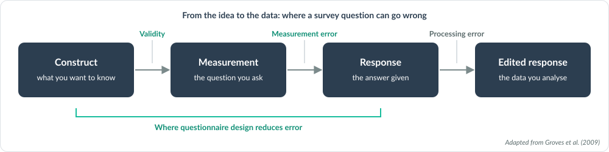
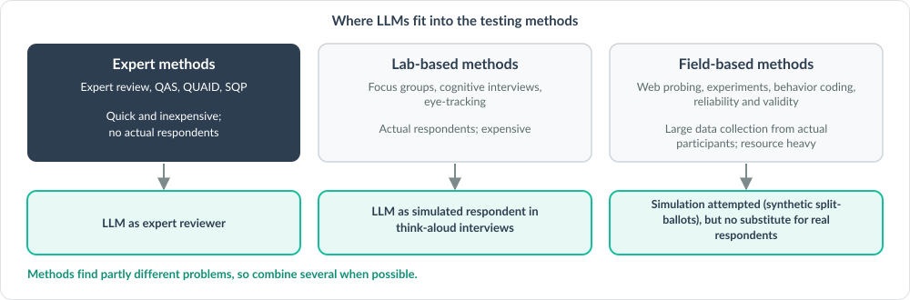
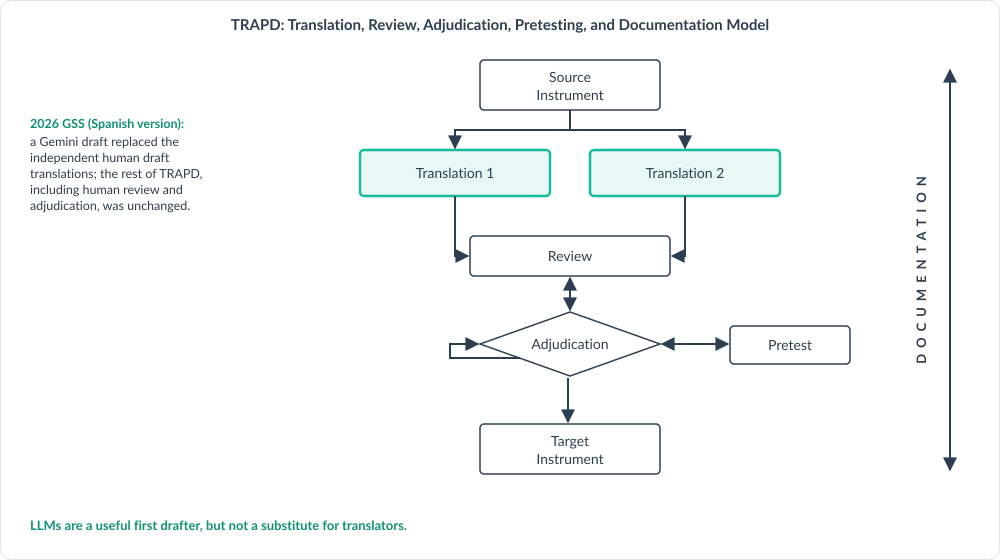

# How QuestionR works and what stands behind it

## What it is built on

The rules QuestionR applies are standard questionnaire design practice, not
the opinions of an AI model. They were drawn from:

- **The Total Survey Error framework** and the model of how people answer
  survey questions: they have to understand the question, recall what is
  needed, form a judgment, and report an answer. Each rule protects one of
  those steps.
- **A webinar series on questionnaire design** given for the International
  Association of Survey Statisticians and the Washington Statistical Society
  by Ting Yan (NORC) and Anna-Carolina Haensch (LMU Munich): general wording
  rules; rules for behavioral, attitudinal and sensitive questions; survey
  mode; putting a questionnaire together; surveys in more than one country
  or language; and the use of AI in questionnaire work.
- **Recent academic studies** of how well AI models write and review survey
  questions, and where they go wrong.
- **Graduate course material** on cognition and survey measurement.

## The frameworks behind the rules

### Total Survey Error

A survey question can go wrong in three ways: it can measure the wrong
concept, measure the right concept imperfectly, or get an answer that differs
from what is true for the respondent. Questionnaire design works on the first
two, validity and measurement error. That is why QuestionR starts every draft
from the construct in your brief, and breaks an abstract construct into
specific, single-dimension parts before it writes a question.

*Groves et al. (2009), Survey Methodology, Hoboken, N.J.: Wiley; Yan,
IASS/WSS Session 1; Peytcheva and Yan (2025).*

### The survey response model

To answer, a respondent has to understand the question, recall what is
needed, form a judgment and fit it to the answer options. A problem at any
stage is measurement error. The general guidelines, such as simple words and
one thing at a time, each protect a stage, and the reviewing model names the
stage when it reports a fault.

*Tourangeau, Rips and Rasinski (2000).*

### Testing questions, and where AI fits

Questions are tested by expert methods, by lab-based methods with real
respondents, and by field-based methods. They find partly different
problems, so more than one should be used. An AI model reviewing questions is
an expert method: quick and inexpensive, but no respondent is involved.
Studies find it a useful but noisy first pass. QuestionR is a first screen
before cognitive interviews or a pilot, not a replacement for them.

*Yan, IASS/WSS Session 2; Haensch, IASS/WSS Session 3.*

### Translation: the TRAPD model

A translated questionnaire goes through translation, review, adjudication,
pretesting and documentation. Back translation is no longer recommended. An
AI draft can stand in for an initial translation, as the 2026 General Social
Survey did for its Spanish version, but review, adjudication and testing stay
with people. A translation from QuestionR is a first draft only.

*Yan, IASS/WSS Session 2; Haensch, IASS/WSS Session 3.*

### Sensitive questions

A question is sensitive when it is intrusive, risks disclosure, or invites
the socially desirable answer, and how sensitive it is depends on the mode,
who answers, the culture and the time. QuestionR's rules for sensitive topics
use forgiving wording, face-saving answer options and open or high-range
formats, and flag when the survey mode itself matters.

*Tourangeau and Yan (2007); Yan (2021).*

## How it keeps the AI in check

- **The rules are written down.** Every model gets the same rules, and the
  tool shows you the instructions before anything is sent.
- **Several models draft; one reviews.** The reviewing model checks every
  draft against a fixed checklist without knowing which model wrote it. It
  recommends questions exactly as drafted and tells you what it still
  doubts.
- **It does not invent facts about a country.** Local terms, units and
  sensitivities are flagged for someone who knows the setting.
- **Other languages.** A version in another language is a first draft only.
  It still needs review by fluent speakers, a decision on disagreements,
  testing with respondents, and a record of what was decided.
- **Everything is recorded.** Each output states the models used, the date
  and the instructions, so the work can be explained and repeated.

## How it was tested

The review step was run on a published test set: 20 questions with 48
planted faults and 7 well-tested questions from the European Social Survey.
It found 36 of the 48 faults (75 percent) and raised fewer than one concern
for every two well-tested questions. It was strongest on questions that ask
two things at once, recall problems and vague wording, and weakest on
sensitivity. This was one run with one AI model on planted faults, which are
clearer than real ones, so treat it as a guide, not a guarantee.

## What it cannot do

- It is an expert review and a first draft by AI models. It is not a
  pretest and does not show how respondents will understand a question.
- It can miss faults and can raise concerns that do not matter. Use your
  judgment, and look at the minor concerns as well.
- Test key questions with real respondents before fielding, and keep the
  record of AI use with the questionnaire.

## The skills behind every answer

QuestionR does not rely on what an AI model happens to know about
questionnaires. With every request it sends the model a set of short text
files, called skills, that write the rules down. Each rule says when it
applies, what to do and what never to do, and most carry a yes or no question
that the reviewing model asks of every draft. Every model gets the same
skills, so changing the model does not change the rules.

| Skill | What it covers | When it is used |
|---|---|---|
| Core | Who the models are told to be, and what every question must meet | Every request |
| Drafting | How a set of questions is built from your brief | Drafting questions |
| Attitude scales | Wording, response scales and balance for attitude items | Drafting an attitude scale |
| Behaviors | Recall, reference periods and counts | Drafting behavior questions |
| Sensitive topics | Questions people may refuse, or edit their answer to | Drafting sensitive questions |
| Survey mode | Web, phone, in person, and more than one mode | Every request; only the modes you choose |
| Other countries and languages | Local terms and sensitivities, and translation by the TRAPD steps: translate, review, adjudicate, pretest, document | When you name a country or a language other than English |
| Questionnaire review | Reviewing a questionnaire question by question and as a whole | Reviewing a questionnaire |
| Brief check | What a designer would still need to know from your brief | When you ask for a brief check |
| Reviewer | How the reviewing model checks the drafts and recommends one set | After the drafts come back |

Open any skill below to read it in full. The skill files, and the published
studies and webinar materials they draw on, are also in the source code: the
[skill files](https://github.com/klinares/drsvyr/tree/main/QuestionR/www/skills)
and the [list of materials](https://github.com/klinares/drsvyr/tree/main/QuestionR/www/skills_materials).
