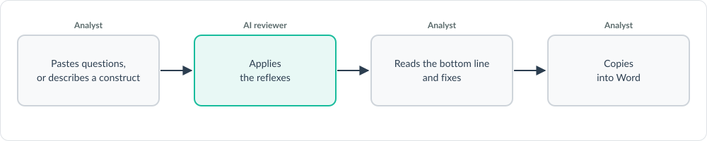

# QuestionR: an AI reviewer and writer for survey questions

QuestionR reads your survey questions the way a survey methodologist would. It tells you which questions are likely to give you wrong answers and why, and it gives you a corrected version. It can also write new questions from a short description of what you want to measure.

It does this with **AI reflexes**: short written rules of good questionnaire design that the AI model is given with every request. The rules come from survey methodology, not from the model. The **Methodology** tab shows every rule and where it comes from.

## What you can do here

- **Evaluate questions.** Paste your questions with their answer options. You get a one-paragraph bottom line, the questions to fix first, and a rewrite of each.
- **Write questions.** Describe what you want to measure and who will be asked. You get finished questions for attitudes, behaviors or sensitive topics, ready for you to edit.

## The error this tool works on

**Measurement error** is the gap between the answer a person gives and the answer that is true for them. It happens when people do not understand a question the way you meant it, cannot remember what you ask about, have to guess, or change their answer before giving it.

*A survey result can be off because of the questions (left) or because of who answered (right). QuestionR works on the left side, and only on the part that comes from the questionnaire itself. It does not address interviewers, how the survey is fielded, or who was sampled and who responded.*

## An example

A question about a foreign leader as it might first be written:

> **Don't you agree that [Name], the president of [Country], has not been a strong and trustworthy leader lately?**
> Yes / No

The same question after review:

> **Have you heard or read anything about [Name], the president of [Country]?**
> Yes / No
>
> *If yes:* **Do you have a favorable or an unfavorable opinion of [Name]?**
> Very favorable / Somewhat favorable / Somewhat unfavorable / Very unfavorable / Don't know

Each change removes one source of measurement error:

| What changed | Why | What it protects |
|---|---|---|
| "has not been" is now worded positively | With a negative in the question, "No" can mean two opposite things | Understanding the question |
| "strong and trustworthy" is now one overall opinion | A person may see the leader as strong but not trustworthy and has only one answer to give | Understanding the question |
| "lately" is gone | Each person would choose their own time span | Understanding the question |
| A first question asks who has heard of the leader | People who do not know a foreign leader would otherwise make up an opinion on the spot | Forming a judgment |
| "Don't you agree" is now "favorable or unfavorable" | The first wording tells people which answer is expected; the second names both sides | Forming a judgment |
| Yes / No is now a scale with "Don't know" | People with a mild view, or none, had no true answer to pick | Reporting the answer |

*An illustration written for this page. Like every rewrite from this tool, it has not been tested with respondents.*

## How it works

1. You paste questions, or describe what you want to measure.
2. The AI model applies the reflexes. For new questions one model writes a draft and a second, stronger model edits it into the final version.
3. You read the result, change anything that is not right, and copy it into Word.

## What to keep in mind

- **You decide.** The tool recommends. You know the subject and the country.
- **It is not a pretest.** It cannot tell you how real respondents will understand a question. Test the important questions with a few people from your survey population before fielding.
- **Do not paste anything you may not share** with the AI service this office uses.

## Before you start

Paste your API key below. It is used for this session only and is not saved.
