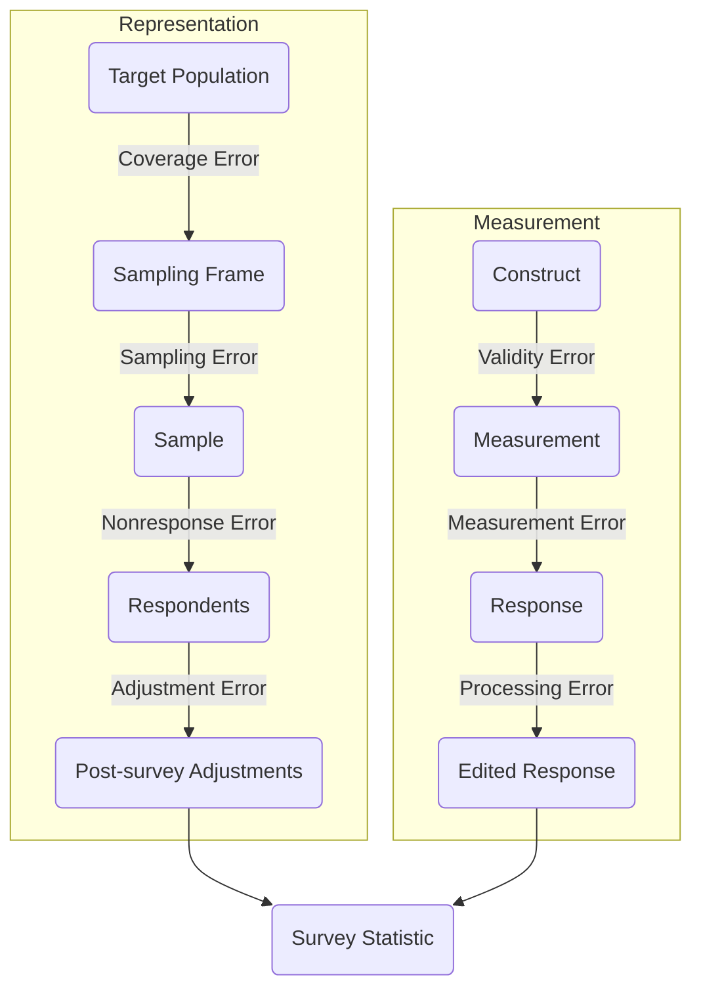
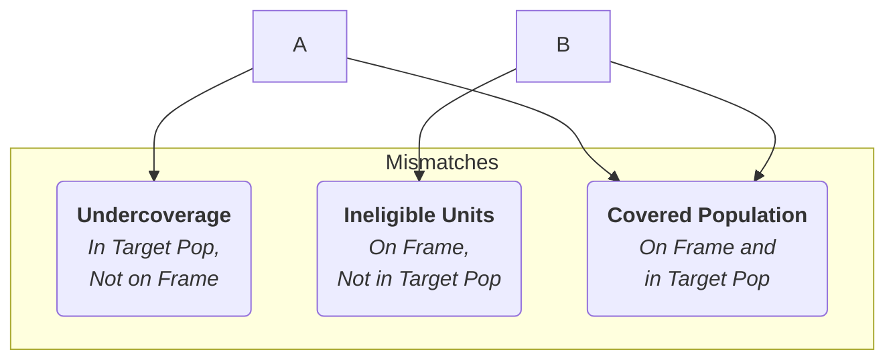

```r
# This chunk sets up the R environment for the document.
# It loads necessary packages for creating plots.
knitr::opts_chunk$set(echo = FALSE, warning = FALSE, message = FALSE)
library(ggplot2)
library(dplyr)
library(tidyr)
```

# Part 1: Foundational Concepts

## The Population Cascade

Understanding survey error begins with clarifying what population is being discussed. The process follows a "cascade relationship" from the abstract to the practical:

1.  **Inferential Population:** The broad, conceptual group to which a researcher wishes to generalize results (e.g., "all homeless youth in the U.S.").
2.  **Target Population:** The specific, operational set of elements to be studied, defined by content, units, extent, and time (e.g., "all homeless youth in Maryland aged 16-19 during 2024").
3.  **Frame Population:** The set of target population members that have a chance of being selected because they are included on the sampling frame (e.g., "all homeless youth who accessed one of six specified shelters in Maryland").
4.  **Survey Population:** The set of frame population members who are ultimately accessible and could become respondents.

## Mean Squared Error (MSE)

The mathematical core of survey accuracy, combining two fundamental error components.

  * **Formula:** $MSE = Bias^{2} + Variance$
  * **Bias:** Systematic, non-compensating errors that consistently push estimates in one direction (errors that "tend to agree").
  * **Variance:** Random, compensating errors creating spread or instability around an expected value (errors that "tend to disagree").
  * **Key Insight:** MSE cannot be zero even in a census due to the persistence of nonsampling errors like measurement and processing error.

## Total Survey Error (TSE) Framework

TSE is a conceptual map that deconstructs the survey process to identify all potential error sources. It has two main arms:

  * **Representation Arm (the "who"):** Errors arising from discrepancies between the target population and the final set of respondents.
      * *Flow:* Target Population → **Coverage Error** → Sampling Frame → **Sampling Error** → Sample → **Nonresponse Error** → Respondents → **Adjustment Error** → Final Statistic.
  * **Measurement Arm (the "what"):** Errors arising from the deviation between a true value and the recorded data.
      * *Flow:* Construct → **Validity Error** → Measurement → **Measurement Error** → Response → **Processing Error** → Edited Data.

<!-- end list -->



## Strengths and Weaknesses of the TSE Framework

| Strengths | Weaknesses |
| :--- | :--- |
| **Comprehensive Nomenclature:** Provides a complete vocabulary for all error sources. | **Excludes Key Quality Concepts:** Focuses on accuracy (MSE) and largely ignores relevance, timeliness, etc. |
| **Error Decomposition:** Allows for targeting the largest and most tractable error sources. | **Implied Independence:** The diagram can falsely suggest error sources are independent when they are often correlated. |
| **Conceptual Foundation:** Organizes the entire field of survey methodology. | **Lack of Routine Measurement:** Many error components (especially bias) are rarely quantified in practice due to cost and difficulty. |
| **Evaluates Trade-offs:** Provides a structure for balancing competing design goals and resource allocation. | **Ineffective Influence on Standards:** Many organizations still only report sampling error, ignoring larger nonsampling errors. |

## Data Quality Dimensions ("Fitness for Use")

Beyond accuracy, a survey's value is judged by a broader set of dimensions:

  * **Relevance:** Meeting the real needs of data users.
  * **Timeliness:** The delay between the reference point and data availability.
  * **Coherence:** Consistency over time and with other data sources.
  * **Accessibility:** The ease with which data can be obtained.
  * **Interpretability:** The availability of metadata needed to use the data appropriately.

# Part 2: Cost-Error Tradeoffs

A fundamental principle of survey design is optimizing the balance between cost and error.

  * **Cost Structure:** Total Cost = Fixed Costs (e.g., questionnaire design) + Variable Costs (e.g., cost-per-interview). However, survey costs are complex and can be nonlinear, discontinuous, and stochastic (variable across cases).
  * **The Optimization Problem:** The goal is to minimize MSE subject to a fixed budget, or to minimize cost for a fixed level of accuracy. This requires specifying both cost and error models as functions of shared design features (e.g., sample size) and solving for the optimal allocation.
  * **Limitations:** In practice, formal cost-error models are often limited to sampling error because the bias components of nonsampling errors are extremely difficult to measure and express as a mathematical function of design features.

# Part 3: Errors of Representation

## Coverage Error

  * **Definition:** Occurs from a mismatch between the **Target Population** and the **Frame Population**. Members of the target population are not represented on the sampling frame and thus have zero probability of selection.

<!-- end list -->



  * **Key Formula:** Coverage Bias = $(U/N)(\overline{Y}_{C} - \overline{Y}_{U})$
      * $U/N$ = proportion of the population that is uncovered.
      * $(\overline{Y}_{C} - \overline{Y}_{U})$ = difference in the mean of the characteristic of interest between the covered and uncovered populations.
  * **Frame Types and Issues**:
      * **Area Frames:** Geographic units; can achieve high coverage but are expensive and subject to lister errors.
      * **Address-Based Sampling (ABS):** Uses postal lists; offers high coverage in many areas but can miss new construction and has issues with P.O. boxes.
      * **RDD Frames:** Random digit dialing; challenged by the rise of cell-phone-only households and high numbers of non-working numbers.
      * **Register Frames:** Administrative lists (e.g., alumni database); quality is highly variable and depends on maintenance.
  * **Key Example (Amaya et al., 2021):** An assessment of ABS frames found that while some estimates (education, household size) were robust, others (fuel type, race, urbanicity) were at high risk of coverage bias once the frame coverage rate dropped below 90%.
  * **Reduction Methods**:
    1.  **Redefine Target Population:** Make it compatible with the frame (e.g., limit to "households with a mailing address"). This reduces error at the cost of relevance.
    2.  **Enhance Frame:** Use multiple frames (e.g., dual-frame RDD for landline and cell), linking methods (e.g., Half-Open Interval), or network sampling (e.g., Respondent-Driven Sampling for hard-to-reach populations).
    3.  **Statistical Adjustments:** Use weighting/calibration (e.g., post-stratification) to adjust the sample to known population totals.

## Nonresponse Error

  * **Components and Measurement:**
      * **Response Rate Formulas (AAPOR):** A standardized way to measure participation.
          * **RR1 (Minimum):** $I / ((I+P) + (R+NC+O) + U)$
          * **RR2:** $(I+P) / ((I+P) + (R+NC+O) + U)$
          * **RR3:** $I / ((I+P) + (R+NC+O) + e(U))$
          * **RR4 (Maximum):** $(I+P) / ((I+P) + (R+NC+O) + e(U))$
  * **Nonresponse Bias Formula:** Bias ≈ $(M/N)(\overline{Y}_{r} - \overline{Y}_{m})$
      * $M/N$ = the nonresponse rate.
      * $(\overline{Y}_{r} - \overline{Y}_{m})$ = the difference between respondent and nonrespondent means.
  * **Theories of Nonresponse**:
      * **Social Exchange Theory:** People respond if perceived benefits outweigh costs.
      * **Social Integration Theory:** More socially integrated individuals are more likely to respond.
      * **Leverage-Salience Theory:** Response depends on which survey features are emphasized and appeal to the potential respondent.
      * **Limitations:** These theories focus on the decision to *cooperate* but not on the process of *contact*. They also tend to assume rational decision-making, whereas people often use quick judgments or heuristics (e.g., throwing out all junk mail).
  * **Key Findings:**
      * **Weak Correlation (Groves 2006; Groves & Peytcheva 2008):** There is a very weak empirical correlation (r ≈ 0.2) between survey response rates and the magnitude of nonresponse bias. A high response rate reduces the *risk* of bias but does not guarantee its absence.

<!-- end list -->

```r
# Simulate data for conceptual plot based on Groves (2006)
set.seed(2006)
n <- 59
response_rate <- runif(n, 0.1, 0.9)
# Weak correlation (r ~ 0.2)
nonresponse_bias <- 0.05 + 0.2 * response_rate + rnorm(n, mean = 0, sd = 0.15)
data_groves <- data.frame(response_rate, nonresponse_bias)

ggplot(data_groves, aes(x = response_rate, y = abs(nonresponse_bias))) +
  geom_point(alpha = 0.7, color = "steelblue", size = 3) +
  geom_smooth(method = "lm", se = FALSE, color = "darkred", linetype = "dashed") +
  labs(
    title = "Conceptual Plot: Weak Correlation Between Response Rate and Bias",
    subtitle = "Based on findings from Groves (2006)",
    x = "Response Rate",
    y = "Absolute Nonresponse Bias"
  ) +
  theme_minimal(base_size = 14) +
  scale_x_continuous(labels = scales::percent) +
  scale_y_continuous(labels = scales::percent)
```

```
*   **Higher Rates Can Increase Bias:** If efforts to increase response rates disproportionately bring in respondents who are similar to existing respondents, it can amplify an existing imbalance and make the sample *less* representative, thereby increasing bias.
*   **Focus on Representation:** The goal should be a representative sample, not simply a high response rate. A balanced sample with a 40% response rate is often superior to a skewed sample with a 60% rate.
*   **Example (Curtin et al., 2000):** A study on the Index of Consumer Sentiment found that excluding hard-to-get respondents (those requiring many calls or refusal conversion) had only a small effect on the final estimates, suggesting the increased effort did not significantly reduce bias for that particular measure.
```

# Part 4: Nonresponse Reduction and Adjustment

## Nonresponse Reduction Strategies

  * **Front-End Techniques:** Advance notification, personalization, incentives, multiple contact attempts, reducing perceived burden, and interviewer training.
  * **Responsive/Adaptive Design (RSD/ASD):** A paradigm that moves away from a single fixed protocol to a data-driven approach during fieldwork.
      * **Responsive Design:** Uses a phased approach. Data from an initial phase is monitored to inform a different protocol for a subsequent phase. A key concept is **phase capacity**, the point where additional effort in a phase yields minimal changes in estimates, signaling it's time to switch protocols.
      * **Adaptive Design:** Involves tailoring protocols to specific subgroups *within* a phase to improve efficiency and balance.
      * **Key Strategies:** Case prioritization (focusing on low-propensity cases) and monitoring quality indicators like R-indicators during collection.

## Weighting Adjustments

  * **Nonresponse Weighting vs. Calibration:**
      * **Nonresponse Weighting:** Uses information known for *all sampled units* (respondents and nonrespondents) to adjust for nonresponse. Assumes data is Missing at Random (MAR) within adjustment cells.
      * **Calibration (Post-stratification/Raking):** Uses *external population totals* (e.g., from a census) to adjust the sample. Can correct for nonresponse, coverage error, and sampling error simultaneously.
  * **Auxiliary Variable Selection (Little & Vartivarian, 2005):** The choice of variables for weighting is critical. The conventional wisdom that weighting is a simple trade-off (lower bias for higher variance) is an oversimplification.
      * **Optimal variables are highly predictive of the survey outcomes (Y).** This is the most important characteristic.
      * **Secondary importance: predictive of response propensity.**
      * When both conditions are met, weighting can reduce **both bias and variance**. Using a variable that only predicts response but not the outcome will needlessly increase variance.
  * **Key Example (2016 Election Polls):** Many state-level polls failed to weight by education. Because education was correlated with both the propensity to respond and vote choice in that election, this omission led to significant, systematic bias in the final estimates.

<!-- end list -->

```r
# Simulate data for conceptual plot of 2016 election polling issue
poll_data <- data.frame(
  group = c("Unweighted Poll", "Actual Result", "Weighted Poll"),
  support_clinton = c(52, 48, 48.5),
  support_trump = c(44, 46, 45.5)
) %>%
  pivot_longer(cols = -group, names_to = "candidate", values_to = "support") %>%
  mutate(group = factor(group, levels = c("Unweighted Poll", "Weighted Poll", "Actual Result")))

ggplot(poll_data, aes(x = group, y = support, fill = candidate)) +
  geom_col(position = "dodge") +
  geom_text(aes(label = paste0(support, "%")), position = position_dodge(width = 0.9), vjust = -0.5) +
  labs(
    title = "Conceptual Plot: Impact of Weighting by Education",
    subtitle = "Illustrating bias in 2016 election polling",
    x = "Poll / Result Type",
    y = "Support (%)",
    fill = "Candidate"
  ) +
  theme_minimal(base_size = 14) +
  scale_fill_manual(values = c("support_clinton" = "#2E74C0", "support_trump" = "#CB454A"),
                    labels = c("Clinton", "Trump")) +
  ylim(0, 60)
```

# Part 5: Errors of Measurement and Processing

  * **Validity Error:** A mismatch between the theoretical construct and what the survey question actually measures.
  * **Measurement Error:** The deviation of a recorded answer from a respondent's true value. Can be caused by the respondent, interviewer, instrument, or mode.
  * **Processing Error:** Mistakes made after data collection (e.g., in data entry, coding, or editing). Can be broken down into two types:
      * **Variable Error:** Random, inconsistent errors (e.g., different coders interpret an open-end differently). This increases **variance**.
      * **Systematic Error:** Consistent, directional errors (e.g., a flawed coding rule is applied to all cases). This creates **bias**.

# Part 6: Post-Survey Errors

## Analytic Error

  * **Definition:** The failure of a data user to employ appropriate statistical methods for complex survey data.
  * **Common Issues:** Ignoring survey weights (leading to biased estimates) and failing to account for complex design features like clustering (leading to underestimated standard errors and incorrect conclusions of statistical significance).
  * **Key Finding (West et al., 2017):** This is a significant problem. A review of published research found that a substantial proportion of studies failed to properly account for survey design in their analysis.

## Imputation for Item Nonresponse

  * **Purpose:** To fill in missing values for specific questions (item nonresponse) to create a complete dataset.
  * **Methods:** Mean imputation (by subgroup), Hot-deck (using a value from a similar "donor" record), Regression-based (predicting from other variables).
  * **Key Assumption (MAR vs. MCAR):** Most modern methods assume the data are **Missing at Random (MAR)**, meaning the probability of a value being missing can be explained by other *observed* variables. This is more realistic than **Missing Completely at Random (MCAR)**, which assumes the missingness is purely a random fluke.
  * **Multiple Imputation:** Creates multiple complete datasets by replacing each missing value with a set of plausible values. This is the preferred method because it correctly accounts for the uncertainty introduced by the imputation process, leading to valid standard errors.
