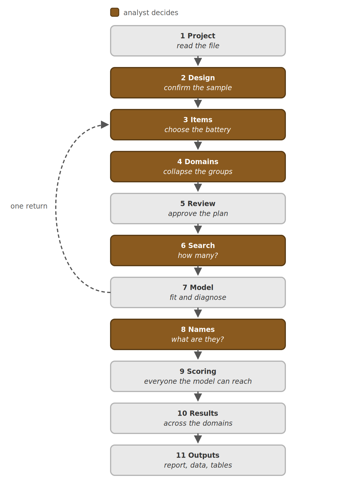

# DrSvyR

Survey data usually gets read one question at a time. This tool asks a
different question: taken together, what does a battery of related answers say
about the people who gave them? It looks for a small number of distinct types
of respondent — people who answer the set in recognisably different ways — and
places every respondent it can reach in the type their answers fit best. Then
it compares those placements across the groups you care about.

Every margin of error it reports comes from how the sample was actually drawn.
That is the point of the tool. Software that assumes people were sampled
independently gets those margins wrong by an amount that depends on the survey
and on the estimate, so the report measures it on your data rather than
assuming it. Where the difference is large, a result that looks decisive under
the independence assumption may not be.

## Before you start

You need a SPSS or Stata file, and you need to know which variables in it carry
the respondent identifier, the stratum, the sampling unit and the weight. You
upload it on **1. Project**, or use the demonstration survey offered there.

The tool works in a temporary folder of its own for your session. Nothing is
written back into your file, and the folder is deleted when you close the tab,
so take your outputs from **11. Outputs** before you leave.

Your respondent records stay on the server running this tool. The AI Survey
Methodologist sees only figures the tool has already computed: how many people
answered a question, how far apart two groups are, how large a segment is. It
never sees a respondent record, and it never sees your data file.

## How it goes

Eleven screens in order. Each waits on the one before it, so a screen that looks
empty usually means something upstream has not been settled yet rather than
that something has gone wrong. The single loop runs from Model back to Items:
if the fitted model tells you the battery was wrong, you can go back and change
it once.

**Search is the slow screen.** It fits every candidate number of groups from
two hundred different starting points, which is what makes the answer
reproducible rather than a property of where the algorithm happened to begin.
Two hundred short runs are taken far enough to tell the promising starts from
the poor ones, and only the best twenty are run to convergence. Give it a few
minutes and leave it alone.

Model is quick, because it does not fit anything. The size you chose was
already fitted during the search and that is the fit you are shown; the time
there goes on the replicate intervals.

## What the tool decides, and what you decide

The tool computes. It does not choose. How many groups there are, which
questions belong in the battery, which category the comparisons are read
against, whether a limitation matters enough to change the conclusion — those
are yours. Each one is recorded along with the evidence that was in front of you
when you made it, so the report can say not just what was found but how it came
to be looked for.

With an API key set below, a language model drafts the segment names and the
written sections from the numbers this tool computed. It drafts; it does not
decide. Every name and every sentence is yours to accept or rewrite, and without
a key the analysis runs exactly the same — you lose the drafts, not the
estimates.

## When something does not look right

Every screen carries a short explanation of what it is showing and why it
matters, so the first place to look is the screen you are on.

If a step fails, the message on screen names the step and the function it
failed in. Copy that message when you ask for help.

Beyond that, the report the tool writes has an appendix called *What was
tested*, which lists what was verified, what rests on published method, what
was a judgement call, and what has not been tested at all. That last column is
the one to read first.

## What you take away

Two downloads on **11. Outputs**:

- **The report**, one HTML file that opens in any browser. It holds every
  table and figure, the decision log and the analysis specification, and any
  table in it can be saved as CSV.
- **Your survey file** with each respondent's segment and the posterior
  probabilities added, in the format you chose.

---

When you are ready, open **1. Project** in the list on the left. It asks for
the survey file to read, and everything else follows from there.
